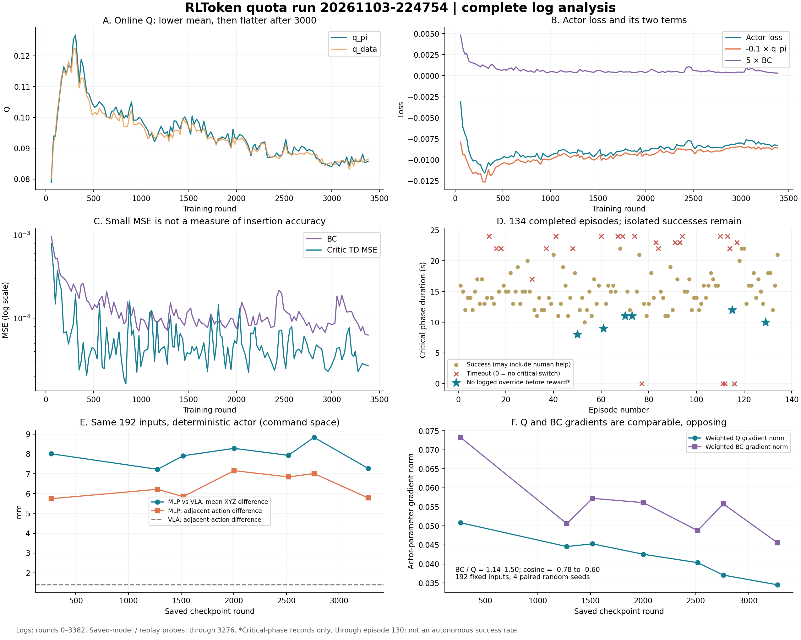

# 11 月 3 日第二次实验：额度模式完整分析

**结论**：本次额度调度、更新计数和保存正常，未见数值发散或随训练加重的推理延迟；但没有形成稳定的自主插入策略。操作者观察到中后期退化，Replay 仍有零星的成功前无干预记录，两者并不矛盾。降低更新强度、扩大窗口未单独解决问题。相较上次实验，本次 Q 梯度已与 BC 同量级，不能继续用“BC 压倒 Q”解释；应优先核对 Q 对动作的偏好能否转化成实际插入改善，尤其是旋转输出与 UR 控制自由度的对应关系。

## 1. 范围、运行时间与保存

只统计 [`20261103-224754-ur_rlt_stage2_ac_mlp`](../../../../../../logs/online_rltoken/20261103-224754-ur_rlt_stage2_ac_mlp/)，不合并当天 17:58 的续训或此前启动短跑。跨日运行按启动日归档；以下时间均为北京时间。

| 项目 | 核对结果 |
|---|---|
| 第一次网络更新开始 | 11/3 22:49:24.646 |
| 最后一次网络更新结束 | 11/4 00:17:50.553 |
| 首末更新经过时间 | 88 分 25.91 秒；Runner 计时 88 分 26.22 秒 |
| 日志末尾 | 00:24:22；00:24:19 启动的第 135 个 episode 未完成，没有新的 Learner 更新 |
| 完成的 episode | 134：110 成功、24 超时；成功包含人工帮助 |
| 最终训练计数 | 3382 轮，16910C＋8455A；C/A 分别为 critic/actor 更新 |
| 最终 Replay | 3502 条＝150 条 warmup＋3352 条在线新增 |
| 最后保存 | `global_step_3276`：16380C＋8190A，Replay 3396 条 |
| 未进入最后 checkpoint | 106 条数据、106 轮、530C＋265A，对应 episode 131～134 |

末条日志晚于最后更新约 6 分 31 秒，不能把 00:17:50 写成程序退出时刻。从目录时间 22:47:54 至末条日志为约 96 分 28 秒，含加载、等待和未结束的最后一轮。

13 个保存点为 `267, 513, 768, 1032, 1276, 1520, 1770, 2003, 2262, 2518, 2762, 3033, 3276`。额度批次结束时越过 250 的保存边界，因此名称不一定是 250 的整数倍。模型和 Replay 探针截止 3276，曲线及 episode 统计截止 3382；二者没有混作同一终点。

## 2. 实际配置与额度核对

采用运行时保存的 [config.yaml](../../../../../../logs/online_rltoken/20261103-224754-ur_rlt_stage2_ac_mlp/tensorboard/config.yaml)，而非事后修改的工作区 YAML。

| 项目 | 本次实际值 |
|---|---|
| 起点 | `resume_dir=null`，在线 actor/critic 从头初始化；冻结 Stage1 step 5000 |
| 调度 | `rlt_schedule.enable=true`、`continuous_updates=false`、`train_every_transitions=1`、`update_epoch=5`；未限制单次消耗额度 |
| 更新比例 | `critic_actor_ratio=2`；在线每新增 1 条分配 5C，actor 按累计 critic 计数交替更新 |
| Warmup | 复用 150 条缓存，执行 150C＋75A；不是 150×5C |
| Replay | `cache_size=5000`、`sample_window_size=5000`、batch=256 |
| Actor 目标 | 在线 `5×BC−0.1×q_pi`；warmup Q 权重 0.02，BC 权重 5 |
| 优化器 | actor/critic 学习率均为 3e-4；裁剪阈值 10；target tau=0.005 |
| Actor 输入与采样 | 参考动作 dropout=0.5；在线 `fixed_std=0.002`，确定性评测不加该噪声 |
| 时域与控制 | gamma=0.96；生成参考 chunk=20，执行/学习 chunk=10；4 步去噪；动作 20 Hz、后台 PD 100 Hz |
| 保存与同步 | `save_interval=250`、`weight_sync_interval=1` |

完整计数符合：`150＋3352×5＝16910C`，`16910/2＝8455A`，`16910/5＝3382轮`。Episode 77、111、112、116 没有进入关键阶段，未增加训练数据或额度；134 个 episode 对应 130 个在线更新批次，加 warmup 共 131 条训练 metrics。没有发现空转增加轮数、额度积压或持续更新模式误开启。

## 3. 机械臂表现与零星自主成功

| Episode | 成功（含人工帮助） | 平均关键阶段耗时 | 新增训练 chunk |
|---|---:|---:|---:|
| 1～30 | 27/30 | 15.70 秒 | 762 |
| 31～60 | 25/30 | 14.93 秒 | 728 |
| 61～90 | 24/30 | 15.83 秒 | 742 |
| 91～110 | 16/20 | 16.80 秒 | 539 |
| 111～134 | 18/24 | 17.24 秒 | 581 |

未切换关键阶段的 episode 不计关键阶段耗时均值。总体含人工完成率从前 30 轮的 90% 降到末 24 轮的 75%，后段关键阶段更长；这与退化描述一致，但人工介入时机、初始条件并未受控，不能据此估计精确自主成功率。

**成功前无干预的证据**：逐条读取最后 checkpoint 的 Replay，将同一 episode 从首条关键阶段记录拼接到首次正奖励，排除奖励出现当步及其后的成功停止/补齐标记。保存范围覆盖主日志 episode 1～130 中的 126 个关键阶段 episode，找出以下 6 次：

| 主日志 episode | 完成时间 | 提交后训练轮数 | 关键阶段耗时 |
|---|---|---:|---:|
| 50 | 23:20:27 | 1290 | 8 秒 |
| 61 | 23:28:45 | 1535 | 9 秒 |
| 70 | 23:37:58 | 1787 | 11 秒 |
| 73 | 23:39:29 | 1848 | 11 秒 |
| 115 | 次日 00:05:48 | 2894 | 12 秒 |
| 129 | 次日 00:14:43 | 3247 | 10 秒 |

“提交后轮数”不是该 episode 执行时的精确权重版本。这 6 次只能称为**关键阶段、奖励前没有记录到干预的成功**，不能排除非关键阶段帮助或未记录条件差异；不将 6/126 当作独立评测成功率。末 4 个 episode 未保存 Replay，无法做同等精度判定。

它们说明后期并非所有输入下都失去成功能力；某些对齐/接触条件仍可能成功。在线采样噪声也可能影响轨迹，但没有证据把这些成功全部归因于噪声。零星成功与“多数时候需要帮助、最终无法稳定自主插入”可以同时成立。

**人工纠偏没有稳定消失**：已保存记录按 1～30、31～60、61～90、91～110、111～130 分段，奖励前含 XYZ 运动的干预动作数，平均每个关键阶段 episode 为 27.4、22.8、23.9、25.0、26.5；未呈现持续下降。该计数是动作槽位，不是按键次数或独立干预事件。

## 4. Loss 的完整走势

下表排除 warmup，按各批实际 critic/actor 更新次数分别加权。不是取各批均值后简单平均。

| 轮数 | q_pi | q_data | BC | Critic TD loss | Actor loss |
|---|---:|---:|---:|---:|---:|
| 31～267 | 0.10509 | 0.10514 | 4.39e-4 | 2.45e-4 | -0.00831 |
| 268～1276 | 0.10247 | 0.10062 | 1.30e-4 | 5.35e-5 | -0.00959 |
| 1277～1520 | 0.09717 | 0.09603 | 1.12e-4 | 5.39e-5 | -0.00915 |
| 1521～2003 | 0.09468 | 0.09358 | 8.88e-5 | 4.92e-5 | -0.00902 |
| 2004～2518 | 0.09012 | 0.08953 | 1.15e-4 | 4.79e-5 | -0.00844 |
| 2519～3033 | 0.08759 | 0.08702 | 8.87e-5 | 4.15e-5 | -0.00832 |
| 3034～3382 | 0.08576 | 0.08567 | 1.11e-4 | 3.81e-5 | -0.00802 |

- **Actor loss 先降后升**：早期 BC 快速下降，随后主要受 Q 下降影响。268～1276 对比 3034～3382，Q 项约使 loss 上升 0.00167，BC 项约抵消 0.00009；并非后期 BC 爆炸。
- **BC 后期波动，没有持续改善**：末段 `bc_ref_loss≈1.21e-4`、`bc_human_loss≈6.09e-5`。该 MSE 混合平移、旋转和夹爪数值，不能把总 loss 开平方直接解释成毫米误差。干预参考被替换，人工分支拟合良好也不等于普通 VLA 输入下复现纠偏。
- **Critic TD loss 小且下降**：表明拟合当前 TD target 的残差变小；不证明同一状态下不同动作的排序准确，更不保证动作梯度有利于插入。
- **没有数值发散证据**：标量未见 NaN/Inf；记录的全模型 actor/critic 梯度范数最大 0.972/0.522，均低于阈值 10。沿用上游的混合统计口径，不能当作两套独立参数的梯度。
- **末段 Q 已较平**：3000 轮后约在 0.084～0.088 波动，不是无止境线性下降。指标平稳与机械臂性能差仍可同时发生。

## 5. Q 为什么先下降、回升，再下降

本次窗口没有填满，**旧经验被淘汰不能解释这次变化**。但均匀采样的数据组成仍在变：warmup 占比由 step 267 的 38.76% 降到 step 3276 的 4.42%；失败轨迹 chunk 从 0 增至 733 条，占末次保存全部 Replay 的 21.58%。较长失败轨迹会贡献更多 chunk，而非每个 episode 等权。

| Replay 前缀 | 在线 episode 成功/总数 | 失败 chunk | 在线记录平均观测折扣回报 |
|---|---:|---:|---:|
| 267 | 10/10 | 0 | 0.11138 |
| 1276 | 42/49 | 247 | 0.08699 |
| 1520 | 52/60 | 285 | 0.09004 |
| 2003 | 68/79 | 399 | 0.08876 |
| 2518 | 82/98 | 583 | 0.08495 |
| 2762 | 92/108 | 583 | 0.08627 |
| 3276 | 106/126 | 733 | 0.08388 |

这些回报按日志中的实际奖励反向折扣，包含人工执行的轨迹；不是当前策略的真实期望 Q，也不是直接把它当 TD target。

**交叉替换数据、critic、actor 后的分解**：均在 CPU float32 上使用真实 checkpoint，固定随机种子，遍历三因素替换顺序后平均，贡献之和等于离线 q_pi 总差；这是一种数值归因，不是物理因果实验。

| 对比 | 数据变化贡献 | Critic 变化贡献 | Actor 变化贡献 | 总 Q 差 |
|---|---:|---:|---:|---:|
| 267→1276（此前阶段报告） | -0.035917 | +0.003576 | -0.000510 | -0.032851 |
| 1276→1520（此前阶段报告） | +0.000382 | +0.011558 | -0.000259 | +0.011680 |
| 1520→3276（本次完整补算） | -0.009332 | -0.005937 | -0.000271 | -0.015540 |
| 2003→3276（本次完整补算） | -0.005876 | +0.001284 | -0.000230 | -0.004822 |

因此早期下降主要来自数据变化，中间回升主要来自 critic 重估；从 1520 看至末次保存，约 60% 的下降来自数据、38% 来自 critic、2% 来自 actor。**单看 2003 以后，critic 贡献反而为正**，不能把完整后期解释为持续下调。

直接检查 q_data 也得到一致结果：

| 固定数据 | 2003 critic | 3276 critic |
|---|---:|---:|
| 2003 Replay | 0.09025 | 0.09250 |
| 3276 Replay | 0.08491 | 0.08629 |

3276 critic 对失败 chunk、成功但距奖励较远 chunk、距奖励不足 30 动作 chunk 的平均 q_data 分别约为 -0.00048、0.03566、0.60960。它能区分这几类样本，但分组依据包含事后结果，不能证明相同状态下动作排序正确。

**解释边界**：平均 Q 下降的来源已能拆开，不等于已证明机械臂退化的唯一原因；actor 替换对平均 Q 的影响小，也不意味着 actor 动作变化小或对真机影响小。

## 6. 动作确实在变，且本次 Q 梯度不能忽略

固定 192 个无干预、非终止输入，使用同一份特征、状态和参考动作比较 7 个 checkpoint；样本来自本次 Replay，不是独立验证集。确定性输出移除 MLP 探索噪声，单位转换基于动作空间的米制平移分量。

| Checkpoint | MLP 与 VLA 的平均 XYZ 差 | MLP 相邻动作平均 XYZ 差 | 加权 BC/Q 梯度范数比 | 两项梯度余弦 |
|---|---:|---:|---:|---:|
| 267 | 8.01 mm | 5.74 mm | 1.44 | -0.64 |
| 1276 | 7.22 mm | 6.22 mm | 1.14 | -0.78 |
| 1520 | 7.91 mm | 5.85 mm | 1.26 | -0.60 |
| 2003 | 8.28 mm | 7.16 mm | 1.32 | -0.67 |
| 2518 | 7.93 mm | 6.84 mm | 1.21 | -0.77 |
| 2762 | 8.84 mm | 7.01 mm | 1.50 | -0.78 |
| 3276 | 7.27 mm | 5.78 mm | 1.32 | -0.61 |

相同输入下，VLA 相邻动作差为 1.40 mm。2003→3276 的 MLP 输出平均 XYZ 差为 6.28 mm，各轴 RMS 为 4.91/3.67/3.34 mm。因此差异并非全由后期状态变化或在线噪声造成。这里是**输出增量的差异**，不是 TCP 实测轨迹偏移，也不能累加成末端误差。

本次加权梯度由 `5×BC` 与 `−0.1×Q` 对 actor 参数分别求导，4 个成对种子，按训练设置启用 reference dropout 和采样。BC 仅为 Q 的 1.14～1.50 倍，且方向明显相反；不同于上次持续更新实验的 68～105 倍。**Q 正在实质参与优化，继续简单提高 Q 权重没有现成依据。** 梯度范数不等于 Adam 实际参数更新量，冲突本身也不自动构成算法错误。固定输入间 Q 的标准差约 0.15～0.16，MLP 相对参考动作的平均 Q 优势仅约 0.0025～0.0039；状态间有明显区分，不等于动作间这些细微偏好可靠。

补充控制变量检查（3276、同192输入）：所有输入统一使用零动作/平均VLA动作/平均MLP动作，只改变状态，Q标准差分别为0.144901/0.146963/0.147678；同状态VLA与MLP动作的平均绝对Q差为0.002520，尺度比约57.5/58.3/58.6。固定动作在部分状态下可能不是实际策略会执行的动作，标准差与平均绝对差也不是同一统计量，因此不能把该比值当成输入重要性的精确比例或动作排序正确性的证据。

现场 RLT 输出日志只取关键阶段内部、排除时间边界附近记录：各阶段 MLP/VLA 平均 XYZ 差约 6.98～8.10 mm，相邻动作差 MLP 约 6.41～6.70 mm、VLA 约 1.15～1.36 mm。非零方向样本中，两者方向夹角大于 90° 的比例从 1276～1519 的 8.4% 增至后期约 14%。这说明调整不只是极小扰动，但参考动作也不是正确答案，不能把方向不同直接当作错误。

3276 在固定输入上反而比 2762 更接近 VLA、更平滑，而操作者报告末期性能仍差。因此“越来越偏离 VLA”“抖动一直增大”都不足以概括全程；动作质量与接触条件、方向及执行效果有关。

## 7. 新线索：Q 偏好的旋转输出与执行自由度

在相同 192 个输入上，将 MLP 输出按 XYZ、roll/pitch、yaw、夹爪四组替换成 VLA 输出，遍历替换顺序，拆解 critic 给 MLP 的平均 Q 优势：

| Checkpoint | Q(MLP)−Q(VLA) | roll/pitch 贡献 | XYZ 贡献 | yaw 贡献 |
|---|---:|---:|---:|---:|
| 1520 | +0.003396 | +0.002428（71.5%） | +0.000916 | +0.000057 |
| 2003 | +0.003389 | +0.002334（68.9%） | +0.001019 | +0.000088 |
| 2762 | +0.003911 | +0.002397（61.3%） | +0.001432 | +0.000141 |
| 3276 | +0.002515 | +0.001508（59.9%） | +0.000941 | +0.000110 |

夹爪贡献略负，完整分解见 [action_axis_probe.json](action_axis_probe.json)。这不是“全部 Q 的 60% 来自旋转”，而是**这批固定输入上，MLP 相对 VLA 那一小部分 Q 优势**的分解。

补充直接替换检查：固定3276的critic、192个输入及MLP其余动作维度，只将r/p替换为同输入的VLA输出，平均Q从0.0872215降至0.0857272，差0.0014943；完整VLA动作的平均Q为0.0847062。此前表格是所有替换顺序的平均贡献，本次是固定其余维度后的直接差，口径不同但结果接近。该批确定性MLP的roll/pitch动作RMS为0.39166°/0.39580°，VLA为0.0000358°/0.001314°。

复核最后checkpoint的3246条在线记录，27440个非干预动作槽位的roll/pitch指令RMS为0.399°/0.409°，对应参考为0.000037°/0.00133°；chunk起点观测的相对roll/pitch姿态RMS仅0.0146°/0.0162°。这支持实际姿态基本锁住、记录的策略指令仍非零，两者不可混同。Replay记录控制指令本身并不构成错误；需要验证critic是否学到了这些指令与真实状态转移的关系。

实际配置为 `selection_vector=[1,1,1,0,0,1]`、控制坐标系角度全零、`force_type=2`。UR 的说明指出：非柔顺轴的 wrench 分量不起作用，即本配置控制坐标系 X/Y 转轴的力矩不是主动跟随通道。[UR force_mode 文档](https://www.universal-robots.com/manuals/EN/HTML/SW5_26/Content/prod-scriptmanual/all_scripts/force_mode_task_frame_selection_vector.htm)

代码仍让 actor/critic 学习完整 7 维动作；[URTargetComposer.target](../../../../../../rlinf/envs/real/ur5e/motion.py) 将 TCP 局部动作和工具偏置变换成目标，[UR5eArm._compute_wrench / _run_controller](../../../../../../rlinf/robotics/parts/arms/ur5e.py) 才生成力矩并交给上述 selection vector。**TCP 局部 roll/pitch 不严格等于控制坐标系 X/Y；工具偏置还可能把旋转转换成平移目标变化。** 因而本次没有证明这些输出完全无效，也没有据此修改自由度。

我的判断：这里有比“平均 Q 下来了”更具体的可疑点——critic 奖励的动作差异可能没有对应等量的有效插入控制，或通过坐标/工具偏置产生非预期的目标变化。应先核对这条动作执行链，再决定投影动作空间、约束输出或调整 Q 权重；不能直接将两维清零并宣称修复。

## 8. 耗时与运行异常

| 记录 | 平均 | P95 | 累计 |
|---|---:|---:|---:|
| Learner update 工作段（16910 次） | 9.95 ms | 13.15 ms | 168.22 秒 |
| 其中 critic 更新段 | 4.08 ms | 4.78 ms | 69.02 秒 |
| 其中 actor 更新段（8455 次） | 4.01 ms | 5.28 ms | 33.93 秒 |
| Rollout 推理（6624 个常规 chunk） | 77.85 ms | 87.22 ms | 515.68 秒 |
| Env 执行段（6624 个常规 chunk） | 522.27 ms | 535.29 ms | 3459.52 秒 |

Learner 工作时间含采样、准备和更新，不等于 CUDA 内核纯耗时；推理/Env 统计不覆盖所有 reset、等待和终止特征补齐。异步各模块累计不能直接相加作为总墙钟时间。

按前 30 分钟、中间 30 分钟、剩余后段分组，推理均值为 77.41/77.87/78.28 ms，执行为 522.00/522.12/522.67 ms；权重同步各训练阶段均值约 20.8～25.3 ms。没有与后期性能下降对应的延迟恶化。单次更新最长 261.9 ms，属于孤立值，不是持续积压。

日志有 FSDP ProcessGroup 设备/弃用等告警；数值记录和更新序号连续，没有缺失 update 计时。当前 basic 计时不能证明相机帧龄、接触状态及每个 PD 周期都正常，也没有本次视频可用于复核插入轨迹；但“越训越慢导致退化”缺乏现有证据。

## 9. 代码与统计口径核对

- **损失符号正确**：[forward_actor](../../../../../../rlinf/workers/actor/fsdp_rlt_ac_policy_worker.py) 是 `−q_weight×Q1＋bc_weight×MSE`，没有把 Q 最小化；`forward_critic` 对 Replay 最终记录动作拟合 TD target。使用 SAC 的模型接口不代表本次启用熵奖励，实际 alpha=0、backup_entropy=false。
- **人工动作覆盖一致**：已保存的干预槽位中，参考动作与 Replay 最终动作的最大差为 0；没有发现这一覆盖链断开。仍需区分“最终请求/记录动作”与机器人受接触约束后的实测位移。
- **成功统计仍不可靠**：外层终止保持路径的 `terminal_hold` 缺失会把成功后补齐计入干预；TensorBoard env 标量只有 125 个汇总点，可能合并多个 episode，不能把标量逐条数成 134 个 episode，也不能简单求和得到自主成功数。本报告用原始 stop/commit 对齐，再用 Replay 奖励前标记复核。
- **更正此前超时说明**：本次和前次配置均为 `rlt_transition_replay=true`，`forward_critic` 实际使用 `dones`，超时也停止 bootstrap。此前阶段报告所写“超时仍继续 bootstrap”不适用于这两次运行，已更正。行为轨迹观测回报与当前策略 TD target 仍不是同一对象。

## 10. 与前一次实验的对比及后续选择

| 项目 | 第一次：17:58 持续更新续训 | 第二次：22:47 额度模式从头训练 |
|---|---:|---:|
| 首末训练经过时间 | 54 分 44.67 秒 | 88 分 25.91 秒 |
| 本次新增 transition | 2223 | 3352 |
| Critic / actor 更新 | 200832 / 50208 | 16910 / 8455，含 warmup |
| 在线 C/新增数据 | 90.34 | 5.00 |
| Replay 窗口 | 2000，旧数据约 49 分 36 秒全部替换 | 5000，最终 3502，未淘汰 |
| 完成 episode | 88（76 成功） | 134（110 成功） |
| 固定输入加权 BC/Q 梯度比 | 约 68～105 | 约 1.14～1.50 |
| 真机判断 | 未持续改善，后段需人工帮助 | 有零星成功，后段自主表现退化 |

两次分别是续训与从头训练，更新比例和采样经历也不同；不能把它们当成仅改变 UTD 的严格对照。能够确定的是：本次重复更新明显减少、没有窗口淘汰，但仍未达到稳定自主插入，**不能继续只归因于高 UTD 或窗口太小**。

建议按以下顺序推进，本次未改训练代码、参数或启动真机：

1. **先核对动作/Q 的有效性**：按真实 TCP 变换、工具偏置和力控自由度，确认 critic 偏好的 roll/pitch 变化实际产生什么目标与运动；这是现有新证据指向的优先事项。
2. **限制策略变化幅度，而非直接增大 Q 权重**：若有效动作链没有错误，可单独尝试将 actor 学习率从 3e-4 降至 1e-4，保留 critic 学习率、UTD=5、窗口5000，以减少每批更新后的毫米级漂移。这是待验证的保守方案，不保证解决方向错误；不要同时改变多个损失权重。
3. **保留中段 checkpoint，最新不自动视为最好**：1520/1770/2003 附近包含多次成功前无干预表现，可作为恢复/对照候选，但没有独立评测证明哪个最好；末次3276不应因训练更久而优先采用。
4. **数据问题聚焦有效纠偏和迁移**：保持已有早期样本，同时关注成功前的运动纠正能否在正常 VLA 输入下被 actor 复现。不能为抬高平均 Q 而删除失败，也不应因 BC 小就认为人工纠正已可靠学会。

## 11. 证据与复算范围

- [logs.json](logs.json)：完整 metrics、134 次 stop/commit、耗时和 TensorBoard 标量；[scalars.npz](scalars.npz) 为数值序列。
- [probe.json](probe.json)：3396 条 Replay、episode 对齐、固定192输入 ID、7个 checkpoint、4种子梯度与两组完整交叉替换；[fixed_actions.npz](fixed_actions.npz) 保存确定性输出。
- [action_output_comparison.json](action_output_comparison.json)：完整现场 VLA/MLP 输出对比；[action_output_pairs.npz](action_output_pairs.npz) 保存配对。关键阶段按秒级日志加1秒边界余量筛选，含模型输出但不是逐步执行归因；非关键阶段 MLP 输出未执行，不据此判断故障。
- [action_axis_probe.json](action_axis_probe.json)、[action_channel_probe.json](action_channel_probe.json)：按动作组替换的 Q 优势及梯度探针。
- [validation.json](validation.json)：源日志/config 的 SHA256、计数核对和离线计算口径。
- [此前2033轮阶段报告](../report.md)、[此前动作报告](../action_output_report.md)保留原截止范围；完整分析以本报告为准，避免将中途结论外推至终点。

分析仅使用 CPU 离线加载和已有日志，没有重新训练或连接机械臂。所有结论区分了现场反馈、已记录统计和离线探针；本次没有独立真机评测来确定最佳 checkpoint 或单一故障根因。

## 12. 后续局部检验（2026-11-04）

此前跨范围标准差与候选动作差的比值不能诊断critic忽视动作。已改用以插入附近为主的870对相邻样本；主组280对中，1520/2003/3276的状态ΔQ与动作ΔQ之比分别20.9/21.2/65.9，严格局部组末期仍为40.2。固定2003 actor后，仅换critic也使2003→3276的动作差缩小约55%。这支持受测局部候选区分减弱，但缺少真实反事实回报，不能断言排序错误或已确定退化根因。方法、筛选限制与复算见[插入附近局部测试](../local_q_near_insertion/report.md)。
