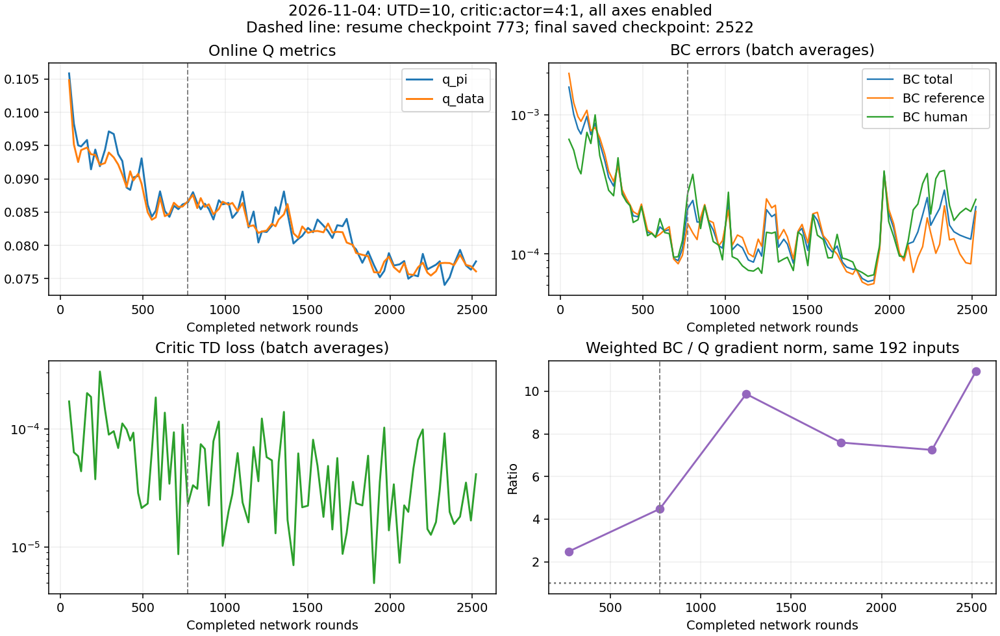

# 2026-11-04：全轴控制、UTD=10、4∶1实验分析

**结论**：本次没有体现出自主插入能力改善。操作者反馈“一直不太好，基本都人工帮助”，Replay中保存的88个在线episode也没有找到奖励前完全无干预的成功。训练/恢复计数与更新额度正常，未发现记录中的数值发散或渐增的推理延迟。相比上次，后期Q对动作的梯度更弱，人工目标BC误差回升；全轴控制下RP姿态分布在warmup阶段就已明显改变，不能把问题只归给网络更新频率。

## 1. 运行边界与时间

本报告只合并以下同一条训练链，不计19:40、19:42的启动短跑：

| 阶段 | 运行目录 | 完整训练范围 | 已完成episode |
|---|---|---:|---:|
| 从头训练 | `20261104-194359-ur_rlt_stage2_ac_mlp` | 0→773 | 35，含7个warmup |
| 续训 | `20261104-203520-ur_rlt_stage2_ac_mlp` | 773→2522 | 61，最后1个只有尾段更新日志 |

- **最新完整保存**：2522轮，25220次critic、6305次actor，Replay2658条；151条warmup＋2507条在线。7个warmup episode整批入库，越过150门槛后实际为151条，属于正常边界。
- **退出前尾段**：第96个episode超时，新增39条，buffer变2697；应产生390次critic额度。最后可见计数25361，较25220多141次，缺少该批完整metrics与新checkpoint。不能说已保存2536轮或2697条；下一次若恢复2522，这39条及尾段更新不会由该checkpoint恢复。

| 时间口径 | 结果 |
|---|---|
| 第一段首末网络更新 | 19:49:04.050→20:07:04.300，18分00.25秒 |
| 续训首末可见网络更新 | 20:37:30.845→21:31:40.692，54分09.85秒 |
| 两段首末更新跨度相加 | **72分10.10秒**，不含中间停机时间，含各段内部采集/等待 |
| 两段Runner至最后完整metrics | 22分10.67秒＋54分16.78秒＝76分27.46秒；第一段包含重新采warmup |
| Learner update工作段累计 | **229.53秒（3分49.53秒）**，含采样/准备/更新的主机计时，不是CUDA纯计算 |
| 96个episode启动执行至停止累计 | **3071秒（51分11秒）**，含VLA阶段与策略等待，不含reset和episode间休息 |

墙钟19:49→21:31还包含约30分27秒的停机/恢复间隔，不能当作连续训练时间。日志续训episode从774编号到834，是runner恢复步数赋给env计数的显示结果；真实本段完成61次，不能把834当累计机械臂episode数。

## 2. 配置与恢复核对

| 项目 | 上次11/3额度实验 | 本次 |
|---|---|---|
| UTD / critic∶actor | 5 / 2∶1 | 10 / 4∶1 |
| 每新增100条更新 | 500C＋250A | 1000C＋250A |
| selection_vector | [1,1,1,0,0,1] | [1,1,1,1,1,1] |
| Warmup | 旧缓存150条 | 新采151条，150C＋38A |
| 其余主要参数 | 窗口5000，batch256，BC5/Q0.1，lr均3e-4 | 相同 |
| 模型与执行 | Stage1 step5000，4步去噪，chunk10，20Hz | 相同 |

只增加了每条数据的critic更新，actor更新强度没有翻倍。总数符合`150＋2507×10＝25220C`；actor按累计计数触发，共6305次。保存点为270、529、773、1020、1251、1502、1775、2023、2279、2522；越过250边界后保存，名称不要求整除250。

**恢复检查**：归档配置除路径/resume外一致；日志恢复`update_step=7730`，首条推理`policy_version=7730`；最后Replay前909条与773 checkpoint逐文件SHA256一致。没有重新训练warmup、丢失旧Replay或误开持续更新的迹象。以上不是验证恢复后随机数与未中断运行逐步完全一致。

## 3. 真机表现：人工完成率不代表自主能力

| 实际episode序号 | 成功/总数（含人工） | 平均关键阶段时长 | 平均奖励前运动干预槽位 |
|---|---:|---:|---:|
| 8～35（首段在线） | 25/28 | 17.04秒 | 94.0 |
| 36～55 | 19/20 | 17.25秒 | 58.8 |
| 56～75 | 15/20 | 19.10秒 | 66.5 |
| 76～95（保存范围） | 19/20 | 18.15秒 | 72.9 |

第96轮另为超时，未保存Replay；76～96按完整日志是19/21、18.43秒。所有96个episode共85成功、11超时；排除warmup是78/89成功。保存到2522的在线范围是78/88成功。

- **无干预成功**：逐episode拼接关键阶段Replay，排除成功奖励当步及以后的停止补齐标记，78次保存的在线成功全部存在奖励前干预。这里不是把末尾补零误当成干预，亦不是独立评测自主成功率。
- **帮助没有消失**：上次同口径运动干预均值约23～27槽位/episode，本次约59～94。槽位是控制动作数，不是按键次数。操作者确认主要靠帮助，与记录一致；干预时机未受控，不能精确量化性能差了多少。

本次更像“一直依赖帮助，中后段未形成稳定自主能力”，不是明显的先学好后完全崩溃。后段含人工完成率回升，也不能解释为自主恢复。

## 4. Loss：后期不只是Q下降，人工BC误差也回升

按各批实际critic/actor更新次数加权，排除warmup：

| 轮数 | q_pi | q_data | BC | Critic TD loss | Actor loss |
|---|---:|---:|---:|---:|---:|
| 16-270 | 0.09624 | 0.09520 | 8.93e-04 | 1.42e-04 | -0.00516 |
| 271-773 | 0.08870 | 0.08795 | 2.00e-04 | 7.13e-05 | -0.00787 |
| 774-1251 | 0.08499 | 0.08495 | 1.48e-04 | 5.04e-05 | -0.00776 |
| 1252-1775 | 0.08282 | 0.08235 | 1.26e-04 | 4.03e-05 | -0.00765 |
| 1776-2279 | 0.07702 | 0.07684 | 1.42e-04 | 3.60e-05 | -0.00699 |
| 2280-2522 | 0.07684 | 0.07723 | 1.74e-04 | 3.34e-05 | -0.00681 |

- **Actor loss**：1252～1775到2280～2522从−0.00765升至−0.00681。约71%的升幅来自Q降低，约29%来自BC增加；不能再说这段完全由Q解释。
- **BC**：同两段`bc_ref`约1.34e-4→1.32e-4，基本持平；`bc_human`约1.14e-4→2.49e-4，约2.2倍。人工mask比例约37.5%→35.9%，并不是仅因采到更多人工槽位。它说明当前数据分布上的人工目标误差变大，不单独证明遗忘；目标难度或内容变化也可能影响。
- **Critic**：TD loss整体降低但批次间仍波动，末段均值3.34e-5。它反映对当前target的拟合误差，不验证同状态动作排序。记录的梯度范数批均值最大actor0.962、critic0.474，未见NaN/Inf；该统计不能排除每个内部更新的瞬时峰值或单独证明从未裁剪。

## 5. 平均Q为何降低：主要仍是数据变化，不能简化成失败太多

固定数据、actor、critic分别交叉替换，4个随机种子、完整Replay、训练式reference dropout=0.5。773→2522离线q_pi变化−0.01074，Shapley分解：

| 来源 | 平均Q变化贡献 |
|---|---:|
| 数据组成/状态变化 | −0.01271 |
| Critic变化 | **＋0.00220** |
| Actor变化 | −0.00023 |

1775→2522也相同：数据−0.00308，critic＋0.00181，actor−0.000095。解释的是固定评估口径下的均值差，非逐条训练日志的精确分解或机械臂退化因果。

**本次不能只归结为“失败数据越来越多”**：773→2522的失败chunk占比仅12.1%→13.6%；warmup占比16.6%→5.7%，成功但距奖励较远的chunk占比63.0%→71.9%。固定最后critic/actor换Replay，q_pi由0.08639降至0.07741；warmup组均值约0.1053，成功远段约0.0322→0.0290。这些数据结构变化共同解释均值降低。窗口尚未满，没有旧经验淘汰。

## 6. Q引导力度：这次后期比上次更弱

同一批192个无干预、非终止输入（160个位于成功中心30mm内、32个外围），保持输入不变，重新求加权`5BC`与`−0.1Q`对actor参数的梯度，4种子平均：

| Checkpoint | BC梯度/Q梯度 |
|---|---:|
| 270 | 2.49 |
| 773 | 4.48 |
| 1251 | 9.87 |
| 1775 | 7.60 |
| 2279 | 7.25 |
| 2522 | 10.93 |

**比值增大主要由Q梯度减弱驱动**：270→2522的Q梯度约0.03661→0.004945；BC约0.09106→0.05404。两项后期并非上次那样强烈反向，2522余弦约−0.079；范数比例不能等同于每维方向或Adam实际更新占比。

跨实验又做了控制：固定本次actor＋本次192输入，只把上次3276 critic换为本次2522，Q梯度0.02282→0.004945，缩小约4.6倍，BC恒为0.05404。固定旧输入＋旧actor时，也缩小约5.5倍。因此不只是新样本更靠近插入造成。

这不证明UTD=10导致过拟合：同时改了控制轴、warmup和实际采集经历。它能否定“多更新critic后，Q动作引导自然变强”的假设；无法仅凭弱梯度判断估值是更准确还是更迟钝。

## 7. 插入附近局部测试与动作变化

沿用前次近邻对照：真实相邻状态，保持动作不变测状态差；保持状态不变测VLA→MLP动作差。此次筛选274对，246对（89.8%）在成功末端中心30mm内，28对为30～50mm对照。主组69对、29个episode，同时限制位姿、速度、力、夹爪与z_rl变化。

| Checkpoint | 只换相邻状态的平均绝对ΔQ | 只换候选动作的平均绝对ΔQ | 比值 |
|---|---:|---:|---:|
| 773 | 0.0036639 | 0.0000811 | 45.2 |
| 1775 | 0.0034666 | 0.0000175 | 198.0 |
| 2522 | 0.0026593 | 0.0000169 | 157.5 |

- **趋势**：773→2522动作差缩小约79%；固定1775 actor候选，仅换critic，动作差仍从3.96e-5降至1.73e-5，下降约56%。不是只因actor候选不同。1775→2522则基本持平，不能说全程持续缩小。
- **边界**：更严格组仅6对，成功最后5个chunk符合筛选的仅1对；两者不用于泛化结论。主组末期比值的episode聚类95%区间约93～244；接触代理组18对为40.5。几何接近不等于已插入，没有反事实执行回报，仍不能判定critic排序错误。也不能把本次158与上次66直接当成故障严重度比例。

同192输入，773→2522的MLP输出XYZ平均差5.93mm；2279→2522也有5.83mm。说明末期策略映射仍在变化，不等于真实轨迹误差或已证明“学歪”。在本次候选上，RP替换的Q变化不再稳定占绝对主导：2522把RP换回参考，平均Q降低约1.43e-5，XYZ为2.16e-5；gripper替换反而提高Q约3.86e-5，各维有交互，不能照搬上次60%～71%的比例。

## 8. RP：全轴控制改变了训练面对的状态分布

| 相同统计口径 | 上次[1,1,1,0,0,1] | 本次全1 |
|---|---:|---:|
| Warmup观测RP RMS | 0.0137° / 0.0143° | **1.277° / 0.498°** |
| 在线全无干预chunk观测RP RMS | 0.0149° / 0.0164° | **1.396° / 1.150°** |
| 在线非人工动作槽位RP指令RMS | 0.399° / 0.409° | 0.230° / 0.302° |
| 本次非人工VLA参考RP RMS | — | 0.000044° / 0.00123° |

**关键证据在warmup**：在线actor尚未训练时，姿态已经出现明显变化，因此不能把全部RP变化归给“后来MLP越学越偏”。本次每episode首次干预前的在线chunk也有约1.313°/0.464°，并非仅人工操作后的残留。

观测是相对参考姿态，指令是动作增量，不能二者直接相减当跟踪误差。全轴控制允许两个旋转方向参与柔顺响应，接触、初始姿态和干预都可能影响观测；仅凭数据还不能把全轴控制定为唯一根因。但冻结VLA参考几乎不提供RP纠偏，而新运行存在度级姿态偏移，这是比“Q平均下降”更具体的任务变化。

在线固定噪声std=0.002，RP小角度处对应约0.115°/动作的采样标准差；全轴设置下该扰动也可能参与实际运动。这里只给出代码尺度换算，不把它视为实测TCP噪声或已确认失败来源。

## 9. 延迟、异常与判断

- **推理/执行**：前/中/后推理约77.3/76.8/79.3ms，执行约525.0/524.5/523.6ms。常规actor权重同步两段均值23.7/22.7ms；排除各进程第一次同步。没有随训练加重的明显阻塞证据。当前basic记录不含逐次PD抖动，不能据此保证每个100Hz周期都正常。
- **调度/数值**：额度与保存计数吻合，Replay未淘汰，resume前缀一致；记录到的buffer警告是auto_save=false后启用5000缓存，不是异常丢数据。结束时存在未完整提交的更新批次，但发生在训练末尾，不能解释此前一直需要帮助。
- **目前最有依据的判断**：全轴控制下，冻结VLA面对的姿态分布明显变化；与此同时，后期critic给actor的动作梯度减弱，人工目标拟合误差上升。三者与自主效果差相容，但尚未建立哪一项是决定性原因。此次不能归因于“系统太慢”或简单说“训练太少”。

**下一步优先级**：若继续定位，优先保留UTD=10、4∶1，恢复原控制轴并使用对应旧轴warmup，从头作单一控制条件对照；不要在这次基础上继续同时提高UTD或BC权重。这样能检验本次新增的控制自由度是否造成主要负担。方案尚未执行，本报告未改训练配置或启动机器人。

## 10. 证据、复算与限制

- [logs.json](logs.json)：两段计数/时间、分段loss、96个episode与源文件SHA256；[config_diff.json](config_diff.json)为归档配置差异。
- [probe.json](probe.json)：95个已保存episode、六个checkpoint、固定192输入ID、梯度和Q交叉分解；[gradient_cross.json](gradient_cross.json)、[q_data_mix.json](q_data_mix.json)、[axis_audit.json](axis_audit.json)为专项复核。
- [local_q/results.json](local_q/results.json)：近邻筛选、同批候选与固定actor对照；[validation.json](validation.json)记录909条恢复前缀一致、88个在线episode chunk数及120组局部统计复核。
- [analyze_logs.py](analyze_logs.py)、[probe.py](probe.py)、[audit_axes.py](audit_axes.py)、[compare_gradients.py](compare_gradients.py)、[analyze_q_mix.py](analyze_q_mix.py)、[local_q/analyze.py](local_q/analyze.py)、[plot.py](plot.py)可在仓库根目录使用`PYTHONPATH=. .venv/bin/python <脚本路径>`复算；先运行日志分析，再运行依赖它的探针。

只保留摘要JSON、压缩NPZ、图和复算脚本，不复制图像/完整Replay；新增目录约1MiB。模型探针为CPU float32，梯度来自当前前后向求导而非优化器历史；不执行更新。动作对照包含离线构造组合，不保证都在原训练分布内。跨实验同时改变了控制条件与数据，不据此建立UTD的单变量因果结论。
