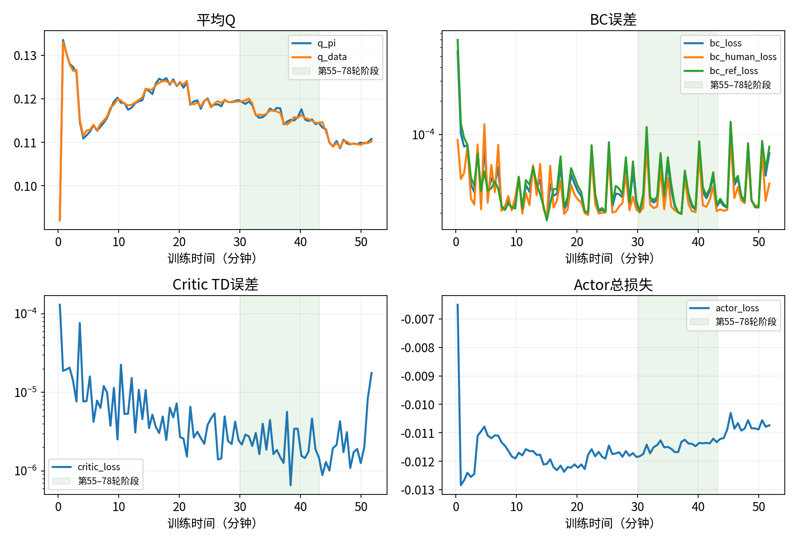

# 2026-11-04 23:07持续更新实验分析

本次恢复RP锁轴、复用旧warmup并使用持续更新。相比此前全轴UTD=10实验一直依赖干预，本次在第55轮开始形成自主成功，20轮滑动窗口最高80%，之后下降到45%。这是目前首次取得较明显阶段性自主成功的训练。操作者补充：原计划训练40多分钟，后期没有像前期那样及时人工纠偏；回落发生在干预条件改变后，不能全部归因于继续训练。继续及时干预能否恢复仍未验证；平均Q下降与策略表现回落不能直接等同。

## 范围与统计口径

- 唯一运行：`logs/online_rltoken/20261104-230711-ur_rlt_stage2_ac_mlp`，无resume。首末完整metrics跨约52分钟；94次执行跨度累计41分20秒。Learner工作段累计31分39.8秒，与rollout并行，不可相加，也不是CUDA纯计算。
- 最后checkpoint22500：180006次critic更新，Replay2153条=150旧warmup+2003在线，93轮。日志到22747轮、181990次critic，最后第94轮成功、Replay2186，但这33条不在22500中，且没有完整episode指标。
- 本报告成功率截至第93轮。逐条Replay拼接，检查奖励前的干预标记，93轮自主判定与先前扣除chunk停止补齐的统计一致，**0处不一致**。原始`success_no_intervened`仍有误判：部分终止补齐动作未带`terminal_hold`。报告不直接使用该原始字段。

## 1. 效果分期

| Episode | 自主成功 | 含人工成功 | 奖励前干预槽位均值 |
|---|---:|---:|---:|
| 1–38 | 0/38 | 37/38 | 82.9 |
| 39–54 | 0/16 | 15/16 | 33.5 |
| 55–78 | 19/24，79.2% | 22/24 | 11.0 |
| 79–93 | 5/15，33.3% | 13/15 | 27.3 |

20轮滑窗峰值80%出现在55–74、59–78窗口，最新74–93为45%。第55轮约在训练30分31秒结束；第一次80%在41分09秒。首次自主之前，所需人工纠偏已减少。后期需要帮助又增加，但不是自主能力完全消失。人工介入策略未受控，不能当作独立冻结模型评测。

## 2. 配置与更新强度

- 本次：`enable=true, continuous_updates=true`，每轮8C+2A；selection_vector=[1,1,1,0,0,1]；batch256，窗口5000，BC5/Q0.1，lr3e-4，gamma0.96，4步去噪，chunk10，20Hz，Stage1 step5000；旧warmup150条、150C。
- 22500保存点的实际累计在线UTD约`(180006-150)/2003=89.79`，每100条在线数据累计约8979C+2245A。这是整体观察比值，不是配置额度。此前全轴实验是1000C+250A/100条，本次约9倍；同时改了控制轴和warmup，不能作UTD单变量结论。
- Replay到退出才2186/5000，未发生窗口淘汰。因此不是旧成功样本被挤出窗口。观测RP RMS约0.0136°/0.0146°，而此前全轴约1.396°/1.150°；原先度级RP偏移在这次已消失。

## 3. Loss与性能不单调一致

按阶段内完整metrics等权统计；每轮均8C+2A。

| Episode | q_pi | q_data | BC | Critic TD loss | Actor loss |
|---|---:|---:|---:|---:|---:|
| 1–38 | .12006 | .12021 | 4.60e-5 | 1.05e-5 | -.011775 |
| 39–54 | .11937 | .11945 | 3.44e-5 | 3.25e-6 | -.011765 |
| 55–78 | .11641 | .11642 | 3.60e-5 | 2.47e-6 | -.011461 |
| 79–93 | .11022 | .11026 | 4.22e-5 | 2.20e-6 | -.010811 |

高表现→后期，actor loss升幅约95.2%来自Q降低，4.8%来自BC增加。BC约增加17%；人工BC从3.00e-5→3.53e-5，参考BC从3.87e-5→4.45e-5。不是仅人工目标误差回升。TD误差继续降低，未见metrics的NaN/Inf，但不能用低TD误差证明Q动作排序可靠。改善阶段q_pi已在下降，因此其方向不能单独判定策略退化。

## 4. 固定输入/模型交叉验证

### 平均Q下降来源

全Replay、四个随机种子，使用训练式reference dropout；分别替换数据、critic、actor，计算三因素Shapley分解。17500→22500：

| 来源 | q_pi变化贡献 |
|---|---:|
| 数据组成变化 | -0.006196（约95.1%） |
| Critic变化 | -0.000307（约4.7%） |
| Actor变化 | -0.000015（约0.2%） |

离线q_pi从0.115978→0.109461。Replay由1629增至2153，旧数据没有消失：warmup占比9.2%→7.0%，失败chunk占比9.5%→10.8%，成功远离奖励chunk占比69.0%→70.1%；是混合组成改变，不能只称“失败太多”。分解解释平均Q，不解释机械臂回落的因果。

### BC与Q对actor的梯度

固定192个无干预非终止输入，其中160个位于成功末端位置中位数30mm内；CPU float32，四种子，重新反传加权5BC与−0.1Q，未执行优化器更新。梯度为actor全部参数的L2范数，非loss数值比或Adam实际更新占比。

| checkpoint | Q梯度 | BC梯度 | BC/Q |
|---|---:|---:|---:|
| 7500 | .001046 | .05049 | 48.3 |
| 12500 | .000844 | .03420 | 40.5 |
| 15000 | .000685 | .05524 | 80.6 |
| 17500 | .000586 | .04296 | 73.3 |
| 20000 | .000437 | .03996 | 91.5 |
| 22500 | .000422 | .03981 | 94.3 |

17500→22500，Q梯度约下降28%，BC约下降7%。当前探针上BC占主导，Q引导继续减弱；不代表整个训练batch都是这个比例，因为该探针特意只选无干预输入。此前全轴实验末期约10.9，上次UTD5约1.1–1.5，样本/训练条件不同，不能据此单独归因UTD。本次高成功率阶段已有弱Q，因此弱Q不足以单独解释失败，更不能说BC主导必然没有效果。

### 插入附近的局部动作对照

沿用相同近邻方法：同一episode真实相邻chunk，均无干预且非终止；位置、姿态、力、速度、夹爪与视觉特征都有限差。306对中281对在成功位置中心30mm内；主组51对、32个episode。

| checkpoint | 只换相邻状态平均绝对ΔQ | 只换VLA/MLP候选动作平均绝对ΔQ | 比值 |
|---|---:|---:|---:|
| 12500 | .007122 | 5.78e-6 | 1232 |
| 17500 | .007041 | 5.08e-6 | 1387 |
| 22500 | .006398 | 3.13e-6 | 2042 |

保持17500 actor候选不变，仅替换critic，动作ΔQ仍从5.08e-6→3.61e-6，减弱约29%。支持“对这些局部候选的区分很弱且后期变弱”，不是证明所有动作都无法区分。成功末5个chunk符合筛选的只有1对，不能把位置接近当成真正接触插入时刻；比例还依赖所选扰动，不应跨实验当故障严重度。

相同192输入上，17500→20000确定性MLP动作XYZ平均L2差6.16mm，其中平均Z偏移+3.30mm；17500→22500为5.42mm。说明策略映射未固定，而当前critic对候选差异的反馈弱。动作差不是实际TCP误差，尚未证明+Z变化造成插不进。

## 5. 延迟与判断

高表现/后期推理均值80.25/80.57ms，chunk执行522.08/522.87ms；12500–17500/17500–22500同步27.43/27.16ms。没有随性能回落而明显加重的延迟，且metrics无非有限值；不代表逐个控制周期毫无抖动。

**综合判断**：本次学出了阶段性自主能力，恢复锁轴后的状态分布也更接近旧训练。后期自主表现回落，但操作者同时减少了及时纠偏，不能确定是继续训练使策略退化。人工帮助能改变后续训练数据，而当轮干预后成功仍不计自主成功；继续干预是否使后续自主表现回升尚未验证。最值得关注的是“持续高频更新＋BC主导＋动作映射仍变化＋Q局部引导弱”的组合。随着自主采集增加，训练human mask比例从高表现阶段29.6%降至后期24.6%，已有人工示范仍在，但每批占比减少；这可能改变拟合方向。它与回落相容，不能据此宣称过拟合或灾难性遗忘已被证明。

优先保留/比较17500与15000；不要把22500自动视为最好，也不建议基于这次结果继续加UTD或BC。80%是在线更新过程的滑窗结果，不是17500固定模型的承诺成功率。若下一次要验证更新强度，固定当前锁轴、warmup与其他条件，只改变持续更新/有限额度之一；此前全轴额度实验不能直接充当对照。本次仅分析，未改训练或推理配置。

## 证据与复算

`analysis.json`保存分期统计、93轮Replay核对、checkpoint状态、固定输入ID、四种子梯度与Q交叉分解；`local_q/results.json`和压缩NPZ保存近邻证据，脚本`analyze.py`、`local_q/analyze.py`、`plot_losses.py`可在仓库根目录用`PYTHONPATH=. .venv/bin/python`复算。源日志哈希记录于analysis.json。不复制Replay/模型，不修改运行；所有模型对照在CPU完成。

产物总大小约752KiB；数组使用压缩NPZ，仅保存局部对照所需数据，未复制原始Replay。
